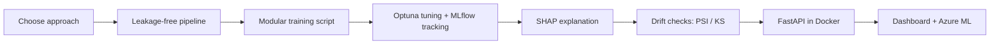

# Day 1 Facilitator Guide: Advanced Machine Learning in Production (4 Hours)

> **Format:** 0.5 day · 240 minutes · 4 modules + introduction
> **Trainer:** Muhamad Majed Tuah Bin Mohd Hafizuddin · **Date:** 23 October 2026
> **Deck:** `Day 1 - Advanced ML in Production (4 Hours).pptx` (46 slides, speaker notes on every slide) and the matching `.pdf`
> **Sources:** Course Outline and Session Plan (repo root), Session 05 XAI deck (visual style), and the topic folders `day1/01` to `day1/08`

---

## 1. What this day achieves

One running case study, a **loan-default model**, travels through the whole production lifecycle:



| Outcome | Participants will be able to… | Module |
|---|---|---|
| (a) | Select classic ML, deep learning or an LLM for a business problem | 1 |
| (b) | Detect data leakage and build a leakage-free scikit-learn pipeline with a fitting validation strategy | 1 |
| (c) | Organise training code into modular, configurable, reproducible scripts | 2 |
| (d) | Tune hyperparameters with Optuna and track experiments with MLflow | 2 |
| (e) | Explain predictions with SHAP and translate them into business language | 3 |
| (f) | Detect drift with PSI and the KS test, and set alert thresholds | 3 |
| (g) | Serve a model as a REST API with FastAPI inside Docker | 4 |
| (h) | Describe production monitoring and how the workflow runs on Azure ML | 4 |

---

## 2. Run sheet (minute by minute)

Times are elapsed from the start of the session. Add your actual clock start (for example, 9:00 AM + elapsed).

| Elapsed | Min | Block | Slides | Method | Materials |
|---|---|---|---|---|---|
| 0:00–0:04 | 4 | Welcome, trainer and participant introductions | 1 | Facilitated introductions | Welcome slide |
| 0:04–0:07 | 3 | Programme overview, objectives, ground rules | 2–4 | Mini-lecture | Programme outline |
| 0:07–0:12 | 5 | Ice breaker: "Would you ship it?" | 5 | Poll + discussion | Ice-breaker slide |
| 0:12–0:15 | 3 | Environment check | 6 | **Checkpoint:** first notebook cell runs | Repo README setup guide |
| **0:15–1:10** | **55** | **Module 1: Trustworthy Data & Leakage-Free Pipelines** | **7–17** | | |
| 0:15–0:25 | 10 | Choosing the right approach | 8–9 | Mini-lecture + quick poll | Session 01 materials |
| 0:25–0:35 | 10 | Data quality and the four leakage types | 10–11 | Mini-lecture + discussion | Session 02 deck |
| 0:35–0:50 | 15 | Hands-on: find every leakage source | 12–13 | Individual → pairs → reveal | `day1/02_data_quality_leakage/notebook.ipynb` |
| 0:50–1:10 | 20 | Leakage-free pipeline and validation strategy (incl. checkpoint) | 14–17 | Live demo + hands-on | Same notebook |
| **1:10–2:05** | **55** | **Module 2: Production Training, Tuning & Tracking** | **18–26** | | |
| 1:10–1:25 | 15 | Notebook to modular scripts; config, seeds, logging | 19–20 | Code walkthrough + hands-on | `day1/03_production_training/scripts/` |
| 1:25–1:45 | 20 | Hyperparameter optimisation; Optuna hands-on | 21–23 | Mini-lecture + hands-on | `day1/04_hyperparameter_optim/notebook.ipynb` |
| 1:45–2:05 | 20 | MLflow tracking and comparing runs (incl. checkpoint) | 24–26 | Demo + hands-on | MLflow UI |
| **2:05–3:00** | **55** | **Module 3: Explainability & Drift Monitoring** | **27–36** | | |
| 2:05–2:25 | 20 | Explaining models with SHAP (global + local) | 28–30 | Mini-lecture + hands-on | `day1/05_explainability_xai/notebook.ipynb` |
| 2:25–2:35 | 10 | From explanation to business narrative | 31 | Pair exercise + review | Waterfall plot from the notebook |
| 2:35–2:50 | 15 | Detecting drift: PSI and the KS test | 32–34 | Mini-lecture + hands-on | `day1/06_data_drift_anomaly/notebook.ipynb` |
| 2:50–3:00 | 10 | Isolation Forest demo, thresholds and cadence (incl. checkpoint) | 35–36 | Trainer demo + discussion | Same notebook |
| **3:00–4:00** | **60** | **Module 4: Serving, Monitoring & Cloud** | **37–46** | | |
| 3:00–3:20 | 20 | FastAPI + Pydantic + Docker, tested with curl | 38–40 | Demo + hands-on | `day1/07_api_serving_containers/app/` |
| 3:20–3:35 | 15 | Six-panel MLOps dashboard, golden signals, SLOs | 41–42 | Walkthrough + discussion | `day1/08_mlops_dashboard/notebook.ipynb` |
| 3:35–3:50 | 15 | Moving to Azure ML (trainer demo) | 43 | Live demo | Trainer's Azure ML workspace |
| 3:50–4:00 | 10 | Action plan, key takeaways, Q&A, feedback | 44–46 | Individual planning | Action plan template, feedback form |

> **Breaks:** the session plan allocates all 240 minutes to content. If a comfort break is required, take 5 minutes from the Optuna hands-on (slide 23, run 15 trials instead of 30) and 5 minutes from the dashboard walkthrough (slide 41).

---

## 3. Before the session (trainer checklist)

- [ ] Participants have Python 3.11, Git and Docker Desktop installed, and the repo cloned from the **students** branch.
- [ ] Ask participants to run `docker pull python:3.11-slim` before the session (the first `docker build` is slow on venue Wi-Fi).
- [ ] `pip install -r requirements.txt` works on a clean machine (scikit-learn, optuna, mlflow, shap, fastapi, uvicorn).
- [ ] Run every notebook top to bottom once on the presentation laptop.
- [ ] Azure ML workspace is open and signed in; environment `credit-model-env:1` and compute `cpu-cluster` exist (Day 2 Session 10 assets).
- [ ] Have a fallback for the Azure demo (screenshots from `day2/02_cloud_training_experiment`).
- [ ] Print or share the personal action plan template and the feedback form link.

---

## 4. Module detail

### Introduction (0:00–0:15)

**Ice breaker: "Would you ship it?"** A model scores 99% accuracy on a loan book where 1% of borrowers default.

- Poll A (ship), B (need more metrics), C (reject). The expected answer is **B**.
- Reveal: always predicting "no default" gives 99% accuracy and 0% recall.
- A real example from our own repo: the Session 02 notebook's clean model scores **99.2% accuracy and catches 0 of 2 test defaults**.

**Checkpoint:** every participant runs the first cell of `day1/01_ai_ml_dl_llm_landscape/ai_ml_landscape_student.ipynb`.

### Module 1: Trustworthy Data & Leakage-Free Pipelines (0:15–1:10)

**Key learning points**

1. AI ⊃ ML ⊃ DL ⊃ LLM. Most enterprise data is tabular, so start with classic ML. Use deep learning for images and audio, and LLMs for free text.
2. Five data-quality dimensions: integrity, completeness, accuracy, timeliness and validity. There are three kinds of missingness (MCAR, MAR, MNAR), and each needs a different fix.
3. Four kinds of leakage: target, train-test contamination, temporal and group.
4. Split first, keep every fitted step inside a `Pipeline`, and match the validation scheme to the data (Stratified K-Fold, `TimeSeriesSplit` or `GroupKFold`).

**Hands-on: find every leakage source (15 min).** For each column, ask: *would I know this value when the loan is approved?*

| Verdict | Columns | Reason |
|---|---|---|
| LEAK | `days_to_default`, `post_approval_status_flag` | Only exist after the outcome |
| RISKY | `loan_approval_date` | Not a feature; use it to order the split |
| RISKY | `customer_id` | Not a feature; use it for group splitting if customers repeat |
| RISKY | `days_since_last_payment` | Safe only if measured as of the application date |
| RISKY | `annual_income`, `credit_score` | Have gaps; impute inside the pipeline, never before the split |
| SAFE | `loan_amount`, `employment_years`, `existing_loans`, `loan_type`, `region` | Known at application time |

**Checkpoint:** the participant's pipeline is scored on a time-ordered split (newest 20% held out) with no leaked feature.

**Quiz:** (1) Why is fitting a scaler on the full dataset a problem? (2) When should you prefer a time-based split? (3) Which column is pure target leakage? Answers are on slide 17.

### Module 2: Production Training, Tuning & Tracking (1:10–2:05)

**Key learning points**

1. Use single-responsibility modules: `data_loader.py`, `features.py`, `train.py`, `evaluate.py`, orchestrated by `main.py` and driven by `config.yaml`.
2. Reproducibility comes from config instead of hard-coded values, fixed seeds, structured logs and saved artefacts.
3. Parameters are learned during training; hyperparameters are set by you. Tune on validation folds, never on the test set.
4. Search strategies: grid search wastes trials, random search beats grid when few hyperparameters matter (Bergstra & Bengio, 2012), and Bayesian search (Optuna's TPE) learns from earlier trials.
5. MLflow logs parameters, metrics, artefacts and tags. Use its UI to compare runs and register the best model.

**Hands-on**

- Run `python day1/03_production_training/scripts/main.py --config day1/03_production_training/scripts/config.yaml` from the repo root. Change `test_size` or `max_iter` and compare the two `metrics.json` files.
- Run an Optuna study with 30 trials in the Session 04 notebook, then log the best run to MLflow and open `mlflow ui`.

**Checkpoint:** `main.py` trains from the command line, and the best Optuna trial appears in the MLflow UI.

### Module 3: Explainability & Drift Monitoring (2:05–3:00)

**Key learning points**

1. Explainability matters for five reasons: regulation (law), stakeholder trust, debugging, bias detection and audit. Post-hoc SHAP removes the old trade-off between accuracy and explainability.
2. SHAP values are additive: f(x) = E[f(X)] + Σφᵢ. The beeswarm plot gives the global view; the waterfall plot explains one applicant.
3. Business translation formula: observed value → direction and size of impact → counterfactual.
4. There are three kinds of drift: feature drift P(X), concept drift P(y|X) and label drift P(y).
5. PSI thresholds: below 0.10 is stable, 0.10–0.20 means watch, and 0.20 or above means alert. KS tests whether two distributions differ, and it flags tiny shifts on large samples, so pair it with PSI.
6. Isolation Forest finds anomalies without labels. Alert only when a human needs to act.

**Pair exercise (10 min):** write three sentences for one applicant: the main driver and its value, its direction and size in plain words, and one action that would change the outcome. Swap with a neighbour and ask whether a branch manager could act on it.

**PSI example on the slides:** computed by `build_deck.py` from a seeded simulation (5,000 training rows vs 2,000 production rows):

| Feature | PSI | Status |
|---|---|---|
| credit_utilization | 0.301 | ALERT |
| age | 0.138 | WATCH |
| annual_income | 0.058 | STABLE (but KS p < 0.001) |
| credit_score | 0.012 | STABLE (but KS p = 0.010) |
| employment_years | 0.010 | STABLE |
| loan_amount | 0.004 | STABLE |

**Monitoring cadence agreed in class**

| Cadence | Check | Action |
|---|---|---|
| Every request | Schema and range validation (Pydantic) | Reject with HTTP 422 |
| Daily | Volume, missing rate, anomaly rate | Investigate if the anomaly rate is more than twice the baseline |
| Weekly | PSI and KS per feature | Watch at 0.1, alert at 0.2 |
| Monthly | AUC and recall on labelled loans | Retrain if below the SLO |
| Quarterly | Model review with the risk team | Re-approve or retire |

**Checkpoint:** one written plain-language explanation of a single prediction, and a PSI table with drifted features flagged.

### Module 4: Serving, Monitoring & Cloud (3:00–4:00)

**Key learning points**

1. FastAPI exposes `/health` and `/v1/predict`, Pydantic validates input, and the model is loaded once at startup. Swagger documentation is generated automatically at `/docs`.
2. Docker: the image is the frozen blueprint and the container is a running copy. Copying `requirements.txt` first keeps the dependency layer cached.
3. A dashboard covers four pillars (model, data, system, business) across six panels. Track Google SRE's golden signals (latency, traffic, errors, saturation) and alert only on SLO breaches.
4. Mapping to Azure ML:

| Built today | Azure ML equivalent |
|---|---|
| Training script plus `config.yaml` | Command job on a compute cluster |
| Optuna study | Sweep job |
| Local MLflow tracking | Built-in MLflow tracking |
| `model.joblib` | Model registry |
| FastAPI plus Docker | Managed online endpoint |
| PSI / KS checks | Model monitoring |

**Hands-on**

```bash
cd day1/07_api_serving_containers/app
docker build -t loan-api:1.0 .
docker run -d -p 8000:8000 --name loan-api loan-api:1.0
curl -X POST http://localhost:8000/v1/predict \
  -H "Content-Type: application/json" \
  -d '{"age": 35, "income": 72000, "credit_score": 710}'
# {"prediction":"No Default","probability":0.1}
```

**Checkpoint:** the container returns a prediction to a curl request, and each participant leaves with a personal action plan.

**Action plan prompts:** one pipeline to audit for leakage, one script to refactor, one prediction to explain to a stakeholder, one drift or alert check to add, and a first step for Monday with a deadline.

---

## 5. If you are running behind

| Behind by | Cut | Keep |
|---|---|---|
| 5 min | The quick poll on slide 9; summarise the table instead | All checkpoints |
| 10 min | Reduce the Optuna study to 15 trials; skip the MLflow nested-run stretch task | MLflow UI checkpoint |
| 15 min | Show Isolation Forest as slides only (no live run) | PSI table checkpoint |
| 20 min | Shorten the Azure demo to the mapping table and one job submission | Docker curl checkpoint and action plan |

---

## 6. Known issues in the repo materials

- **Session 02 notebook:** the synthetic data has a 0.7% default rate (about 8 defaults in 1,200 rows). The clean model's ROC-AUC values (0.04 to 0.13) are artefacts of this, so don't present them as benchmarks. Use the result instead to show why accuracy misleads on rare classes. One "leaky model" cell raises a NaN error; the later duplicate cell imputes first and runs.
- **Session 03 `main.py`:** the default `--config` path is Windows-style. Always pass `--config` explicitly and run from the repo root.
- **Session 07 API:** it uses a rule-based stand-in model on purpose. The production upgrade is to `joblib.load()` the Module 1 pipeline at startup.

---

## 7. Regenerating the deck

The deck is generated by `build_deck.py` (python-pptx). Edit the script, then run:

```bash
pip install python-pptx numpy scipy
python build_deck.py                      # writes the .pptx (code font: Consolas)

# PDF export via LibreOffice (Consolas is not available there, so use a bundled mono font)
DECK_MONO_FONT="DejaVu Sans Mono" DECK_OUT="/tmp/day1.pptx" python build_deck.py
soffice --headless --convert-to pdf /tmp/day1.pptx
```

`assets/` holds the SHAP beeswarm and waterfall images, which were reused from the Session 05 deck.

---

## 8. References

Aon (2026); Bergstra & Bengio (2012); Kapoor & Narayanan (2023); Lundberg & Lee (2017); Maslej et al., Stanford AI Index (2025); Microsoft, What is Azure Machine Learning (2026); scikit-learn developers, Common pitfalls; Sculley et al. (2015); Wilkinson, CIO Dive (2024); World Economic Forum (2025). Full citations are in the Course Outline.
